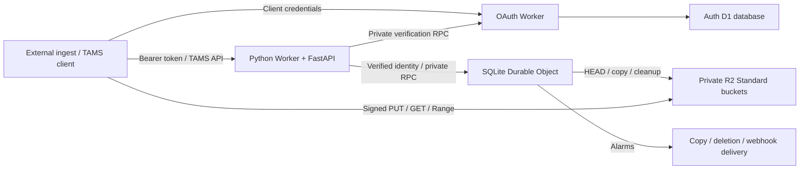

# Architecture

The Worker authenticates API calls and forwards them to one Durable Object per installation. FastAPI runs through Cloudflare's official ASGI integration. HTTP handlers and dependencies are async; shared TAMOSS domain rules remain synchronous. An explicit native SQLite transaction encloses each API request and rolls back error responses. A store lock protects allocation identities across R2 checks and metadata changes.

Better Auth issues scoped JWTs from a separate TypeScript Worker. The Python Worker calls its private verification entrypoint through a service binding; JOSE checks the signature and claims against cached public keys. Verification availability is therefore part of API availability. Verified identities travel through Durable Object RPC and request-local ASGI state, never client-controlled identity headers. FastAPI applies the route permission policy before calling domain operations. Auth storage is independent of TAMS metadata and media.

Client administration uses supported Better Auth server APIs through Wrangler's D1 proxy. Only token issuance, public keys and OAuth discovery are exposed over HTTP. Worker secrets contain signing-key encryption material; D1 stores hashed client secrets and encrypted private signing keys. The operator password remains local. Operational logs contain request paths, status and Cloudflare request identifiers, without credentials or token bodies.

Each record is persisted separately as JSON in SQLite. Segments have their own table and indexes for Flow, Object, init Object and time bounds. Fixed-width decimal time keys preserve integer nanoseconds without passing large integers through JavaScript numbers. API responses retain the original TAMS time strings. Flow and Source listing filters reuse TAMOSS's Python logic and load the relevant metadata collections; these listings should be measured before increasing the store substantially.

R2 keys include an allocation UUID and an installation prefix. A queued delete therefore cannot target a replacement allocation using the same public Object ID. Metadata deletion queues physical cleanup in the same transaction. Alarms persist a retry before external I/O and replace that alarm only after computing the next deadline. An empty store has no recurring maintenance alarm. Completed job records are retained for one day.

Webhook configuration and delivery records live in SQLite. The allowlist is operator-controlled; the installation has no private-network receiver support. A webhook send may be repeated if the Worker stops after the receiver accepts it but before the result is persisted.

## Scope and limits

One Durable Object keeps cross-Flow metadata operations within a single transaction boundary. Requests and alarm batches run serially, so copy and webhook I/O can delay metadata requests. This suits a modest installation; measure listing and webhook workloads before increasing traffic. Partitioning the store would need an explicit design for cross-Flow transactions.

Media bytes bypass the API Worker through R2 signed URLs. Clients handle ingest, decoding and playback timelines. Authentication and transfer checks alone cannot establish that encoded media timestamps match the TAMS timeline. See [operating limits](reference.md#scope-and-limits) for the supported scope, request sizes and lifetimes.

The native APIs used here are [Python FastAPI support](https://developers.cloudflare.com/workers/languages/python/packages/fastapi/), [SQLite storage and transactions](https://developers.cloudflare.com/durable-objects/api/sqlite-storage-api/), [R2 bindings](https://developers.cloudflare.com/r2/api/workers/workers-api-reference/) and [R2 presigned URLs](https://developers.cloudflare.com/r2/api/s3/presigned-urls/). The API contract is pinned to [BBC TAMS 8.2](https://github.com/bbc/tams/tree/8.2).
